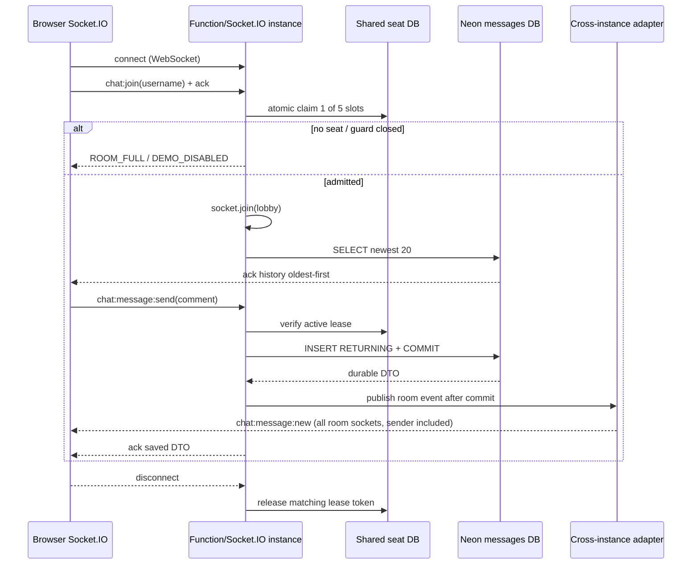

# リアルタイムチャット 設計書（草案）

## 1. 設計状態

この文書は docs-only 段階の設計候補であり、DB / Vercel の適用済み設定を示さない。教材正式要望の WISH ID は未確認である。REQ は `02_requirements.md`、TASK は `04_implementation.md`、TST は `05_test_spec.md` と対応する。

Vercel の公式 WebSocket 機能は2026-10-20にGAとなった。Node.js/Express と Socket.IO は公式に案内されているが、配置パス、HTTP server export、プラン/Function 実効時間、デプロイルーティングはこのリポジトリでは未実測である。[Vercel WebSockets](https://vercel.com/docs/functions/websockets) [GA告知](https://vercel.com/changelog/websocket-support-is-now-generally-available)

### Design IDs

| DES          | 設計要素                                                               |
| ------------ | ---------------------------------------------------------------------- |
| DES-CHAT-001 | Express / shared HTTP server / Vercel entry と静的画面統合（§2, 7）    |
| DES-CHAT-002 | Socket lifecycle、event/ack、安全な入力・公開停止境界（§3, 4, 10, 11） |
| DES-CHAT-003 | 投稿・履歴のDB schema、transaction、DTO、history/live merge（§5, 9）   |
| DES-CHAT-004 | 共有5席 atomic lease、fencing token、異常終了回収（§5, 10）            |
| DES-CHAT-005 | 複数インスタンスadapter比較・選択・配送失敗窓（§5, 6）                 |
| DES-CHAT-006 | Browser UI、再接続、状態・履歴同期・重複排除（§4, 5, 9, 10）           |
| DES-CHAT-007 | Vercel Function lifecycle/transport/Neon Pool接続運用（§7, 8）         |
| DES-CHAT-008 | Chat専用fail-closed公開制御、security constraints（§10, 11）           |

WISH → REQ → DES → TASK → TST の全対応表は `02_requirements.md` のトレーサビリティ表に記載する。

## 2. 現行構成・変更方針

- `src/app.ts` は既存 Express app を構築/exportし、`public/` static と既存機能 Router を保持する。
- `src/server.ts` の `app.listen()` は Socket.IO と共用できない。共通 `node:http` server を一つ作り、その server に Socket.IO `Server` を attach する構成へ移行する。ローカルは同じ server を listen。
- Vercel Function は接続を受理した Function instance に固定する。Vercel の Node server framework 例に沿うなら、`createServer(app)` と Socket.IO を持つサーバーを Function handler として export する必要がある。Socket.IO path は Function URL と整合させる。現在の `src/server.ts` の `listen()` をそのまま Function entry とみなさない。
- Vercel は Function route と Socket.IO path の対応を要求する。単一の Express app の既存 `/`, `/todo`, `/ai` 等の経路を保つ Vercel routing と `api/...` export 方法を、最小の route mapping を含めて staging で検証する。必要性を確認する前に設定を追加しない。Zero Configuration が WebSocket path を処理すると推測しない。
- `/chat/` は `public/chat/index.html` を静的配信する案。Express static directory index が `/chat` から `/chat/` を処理することは実装前にローカルで実測し、必要なら明示ルートを追加する。Socket client JS は静的 HTML から Socket.IO client を読み込むが、配信元・版をサーバーと一致させる。
- 既存 `/api` と AI/TODO の middleware order、404/error契約は変えない。Socket handshake と chat event handler の公開停止を独立して fail-closed にする。

### 候補ファイル構成

```text
src/
  app.ts                         # 既存 Express app; 最小変更
  server.ts                      # local listen only
  httpServer.ts                  # node:http server + Socket.IO attach/factory
  apps/chat/
    chatRouter.ts                # 必要なHTTP health/entry routeがある場合のみ
    chatController.ts            # event境界からserviceへ渡す薄い制御
    chatService.ts               # 入室・検証・保存後broadcastの順序
    chatModel.ts                 # parameterized SQL、transaction、DTO
    chatMiddleware.ts            # fail-closed環境/handshake gate
    chatSocket.ts                # socket lifecycle / event registration
    chatTypes.ts                 # event、ack、DTO
public/chat/
  index.html
  app.js
  style.css
sql/chat/
  050_create_chat_tables.sql     # 追加DDLの候補。実行・作成は後続タスク
tests/server/chat-*.test.ts
tests/e2e/chat.spec.ts
```

Socket.IO adapter 用補助テーブルを使うなら同じSQLへ含めるか、番号付きの次ファイルへ分けるかは adapter のDDLとレビュー後に決定する。既存テーブルに対する変更/削除はしない。

## 3. コンポーネント責務

| コンポーネント            | 責務                                                                                                     |
| ------------------------- | -------------------------------------------------------------------------------------------------------- |
| app                       | 既存 Express routes/static/EJS。chat pageへの追加は必要最小限                                            |
| shared HTTP server        | ExpressとSocket.IOの同じ Node HTTP server。localとVercel entryで共用                                     |
| Socket router/gate        | path/handshakeと公開停止を確認。停止時はイベント登録/履歴/DBを実行しない                                 |
| Socket controller/handler | payload型確認、ackを一度返す、service呼出し。HTTP Responseには依存しない                                 |
| Service                   | admission → join/history、参加検査 → validation → DB transaction → adapter broadcast/ackという順序を管理 |
| Model                     | Neonへの固定・parameterized SQL、transaction、DB値からDTO変換。Socket/HTTPへ直接応答しない               |
| browser client            | 接続状態、join/rejoin、送信、history/new event のID dedupe・order、textContent描画                       |
| shared seat store         | 全 Function instance 合計の最大5 leaseを原子的に割当・更新・解放                                         |
| Socket.IO adapter         | instance間のroom event伝搬。単独では共有席数や永続履歴を管理しない                                       |

チャットは参加者同士のテキスト機能であり、Gemini SDK/AI serviceを呼ばない（REQ-CHAT-018）。

## 4. HTTPとSocket.IO契約案

### HTTP

| Method / path       | 用途                                                                              |
| ------------------- | --------------------------------------------------------------------------------- |
| `GET /chat/`        | 静的チャット画面。API停止中も表示だけ可能にする案                                 |
| Socket.IO handshake | 専用path（Vercel上の `api/<function>/socket.io` と整合）。公開停止時はupgrade拒否 |
| その他              | 既存404を維持。chat投稿をREST APIで重複実装しない                                 |

### Client → Server event と ack

すべてのeventでJSON object、必須field型、最大payload bytesを確認。message eventは入室済みかをDB/leaseでも照合する。

| Event                   | Request payload        | Ack成功                                                                              | 主なエラー                                                                                  |
| ----------------------- | ---------------------- | ------------------------------------------------------------------------------------ | ------------------------------------------------------------------------------------------- |
| `chat:join`             | `{ username: string }` | `{ ok:true, roomId:'lobby', messages: ChatMessage[], occupied: number, capacity:5 }` | `DEMO_DISABLED`, `VALIDATION_ERROR`, `ROOM_FULL`, `DB_UNAVAILABLE`                          |
| `chat:message:send`     | `{ comment:string }`   | `{ ok:true, message:ChatMessage }` — DB commit後のみ                                 | `NOT_JOINED`, `VALIDATION_ERROR`, `PAYLOAD_TOO_LARGE`, `DB_UNAVAILABLE`, `ROOM_UNAVAILABLE` |
| `chat:leave` (optional) | `{}`                   | `{ ok:true }`                                                                        | cleanupは冪等。disconnectでも同処理                                                         |

Server → Client `chat:message:new` は `{ id:number|string, username:string, comment:string, createdAt:string }`。DB ID型が BIGINT なら JS `number` の安全整数を越え得るため、**idは10進文字列**とする候補を推奨。現行依頼はID型を指定していないので、最終DTO型は実装前に採択する。

エラーackは `{ ok:false, error:{ code, message } }` の固定文。候補 code は `DEMO_DISABLED`, `ROOM_FULL`, `NOT_JOINED`, `VALIDATION_ERROR`, `PAYLOAD_TOO_LARGE`, `DB_UNAVAILABLE`, `ROOM_UNAVAILABLE`, `INTERNAL_ERROR`。内部例外・SQL・接続文字列・stackは返さない。

## 5. DB・共有席設計案

### 投稿履歴

候補 `chat_messages`: DB identity key, `room_id`, `username`, `comment`, `created_at timestamptz default current_timestamp`; index `(room_id, created_at DESC, id DESC)`. `id` は長期採番を考慮して `BIGINT GENERATED ALWAYS AS IDENTITY` を候補とする。`username` と `comment` の空白/コードポイント制約は TypeScript と SQL で一致させ、SQLだけを正としない。日時同一時は ID を tie-breaker とする。

入室履歴は DB query `ORDER BY created_at DESC, id DESC LIMIT 20` 後に応答用を昇順へ反転。履歴取得と live event が競合するため、browser は ID keyed map/upsert後に `(createdAt,id)` 順にし、最大20件へ trim。DB IDを文字列で選ぶ場合は数値比較でなく DB order または BigInt比較を使う。

### Seat / lease

クライアント内メモリの count、Socket.IO room人数、Postgres adapter は全体定員保証に使えない。候補 `chat_room_seats` は単一 room の固定 slot 1〜5を持ち、各 row に socket/lease owner token と `expires_at` を記録する。参加時は PostgreSQL transactionでseat rowを lockし、空または期限切れ1 slotのみ取得。DB clock の `CURRENT_TIMESTAMP` を基準とする。5 slotを超える insert を通常 runtime role に許さず、table accessを最小権限にする。

- graceful disconnect/leave は一致する fencing token を条件に解放し、繰返し可能にする。
- 生存 connection は Socket.IO heartbeatとは独立した lease renewal を行う。renewに失敗・DB不明なら投稿と新規参加を止め、seatが確保されたと見なさない。
- abrupt process termination は `expires_at <= CURRENT_TIMESTAMP` のseatを次の割当で回収する。期限切れまでは一時的に「満席」と誤る方向を選び、定員超過を避ける。lease length/renew frequency/heartbeatとの関係は未確定。
- 2プロセス同時参加は同一seat rowsをtransaction lockし、一方だけが最後のslotを得る。固定slot seed/再実行/欠損時の停止条件を DDL testする。

### 投稿と配信順序

1. socket が参加済みか、room/lease/fencing tokenが有効か共有DBで確認。
2. payloadをtrim/validate。
3. transactionでINSERT ... RETURNING。transaction commit完了を確認。
4. commit後に `io.to(room).emit('chat:message:new', dto)`。
5. senderにも room broadcastで同じIDを通知する。clientはackとbroadcast双方が届いてもID upsertで一件にする。
6. INSERT/commit失敗時はemitせず安全な `DB_UNAVAILABLE` ack。保存後、adapter broadcastに失敗する障害窓では履歴再読込で回復する設計が必要。完全な再配信保証が要求される場合はTransactional Outboxと独立publisherが必要で、Function内の短命バックグラウンド処理だけに依存できない。

### V2 connection separation

履歴は `room_id='lobby'` のチャットテーブルだけから読む。AI V1/V2 の会話/履歴を取得・送信しない。V2の `ai_v2_conversations`、`ai_v2_turns` とTODOテーブルへ chat用DDLから触れない。

## 6. 複数インスタンス方式比較

| 方式                                                        | 配信                                              | 最大5席                       | Neon / Vercelへの注意                                                                                                                                                                                      | 評価                                                                              |
| ----------------------------------------------------------- | ------------------------------------------------- | ----------------------------- | ---------------------------------------------------------------------------------------------------------------------------------------------------------------------------------------------------------- | --------------------------------------------------------------------------------- |
| Node local room/countのみ                                   | 各instance内のみ                                  | 不可                          | Vercelではsocketがinstance固定、再接続先は変わり得る                                                                                                                                                       | 不採用                                                                            |
| Redis Adapter + Redis lease                                 | Redis pub/sub                                     | Lua/atomic keyで可能          | Redis/Marketplace契約とsecret、lease設計が追加で必要                                                                                                                                                       | 運用簡明だが新外部サービス。今回選定/作成しない                                   |
| Socket.IO Postgres Adapter + separate PostgreSQL seat lease | PostgreSQL `NOTIFY/LISTEN` によるevent forwarding | transaction + row locksで可能 | Neon通常 pooled PgBouncer transaction mode は `LISTEN/NOTIFY` 非対応。adapter用のsession-capable/direct connectionが必要で、各active instanceにlistener接続が残る。Neon接続上限とVercel instance増加を評価 | Neon再利用の第一候補だが、session connectionの寿命/数がVercelと整合するかは未検証 |
| DBをpollして自作同期                                        | message tableを短周期poll                         | transactionで可能             | DB負荷・遅延・重複/カーソル管理が増える                                                                                                                                                                    | Postgres Adapterより負荷・実装が増えるため原則避ける                              |

Socket.IO Postgres Adapter は inter-server broadcastのみで、座席管理・永続履歴・再接続回復は別責務。公式 adapter は `LISTEN/NOTIFY`、大きい/バイナリ payload のattachments table、connection state recovery非対応を明記。adapter障害がnode-local fallbackになる構成を避ける。[Postgres adapter](https://socket.io/docs/v4/postgres-adapter/) [Socket.IO adapters](https://socket.io/docs/v4/adapter/)

## 7. Vercel 配置・transport

- Vercel WebSocket はGAで、Functionが接続を受理し、その接続は最大実行時間まで当該 instance に pin される。次のconnection/reconnectが同じ instance に来る保証はない。in-memory count/roomを全体状態に使わない。
- Expressは `node:http` の `createServer(app)` に載せ、同一serverに `new Server(httpServer)` をattachする。Vercel公式Node framework例はその server をFunction handlerとしてexportする。
- Socket.IO client pathは Vercel Function URL配下へ明示する。Vercelでは `transports: ['websocket']` が必須。Socket.IO defaultのlong-pollingを含むtransport fallbackは使えない。このWebSocket-only構成ならtransport用sticky sessionは不要だが、跨instance room broadcastと共有presence/seatは依然外部共有が必要。
- ローカルは `src/server.ts` が共有HTTP serverをlistenし、VercelはFunction entryからそのserverをexportする候補。既存プロジェクトのroot Express deploymentとのrouting衝突を解くには、VercelのBuild/routeでExpress app全体とsocket upgradeを同じ実行pathに届ける必要がある。Stagingで静的 `/`, TODO, AI, `/chat/`, handshakeを確認するまで公開停止を解除しない。
- Vercel Functionの実行上限はPlan/Fluid Compute/Function設定により変わり、接続が最大実行時間に達すると切断される。Vercel公開資料は2026-11-25時点でFluid Compute default 300s、通常のNode Function maxはHobby 300s / Pro・Enterprise 800s、Pro/Enterpriseの1800sは条件付きbetaと記載。ただしこれはプロジェクト実効値ではない。deployment dashboard/configを実測し、推測値を運用値にしない。[Function limits](https://vercel.com/docs/functions/limitations) [Fluid Compute](https://vercel.com/docs/fluid-compute)
- クライアントはSocket.IO reconnect後、`chat:join` を再送して新しいseat取得・最新20履歴を再取得。adapterはconnection-state recoveryをサポートしないため、local socket roomsや過去event stateを再利用しない。
- Vercel local `vercel dev`/localhostは同一プロセスでの基本機能確認に限る。2 node、Vercel edge/CDN upgrade、最大実行時間切断、跨instance reconnect・seat統合はdeployed Previewでの専用試験が必要。実環境検証は安全性/公開停止条件の承認後。

## 8. Neon Poolと接続数

現行 `src/db.ts` は1 `pg.Pool` per Node process、`max:2`。これはVercel全体の上限ではない。instance数Nでアプリ pool が理論上 `2N` clientを取り得るのに加え、Postgres adapterのpersistent LISTEN接続・SQL workloadが必要になる。NやNeon quotaはプロジェクト設定依存で未確認。instance scale-outがNeon connection capacityを超えない容量設計が必要。

Neon公式は通常の pooled endpointがPgBouncer transaction modeで、`LISTEN/NOTIFY` はpooled connectionでは非対応、session機能が必要ならdirect connectionを使う旨を明示する。したがって現在の `DATABASE_URL` がpooler hostかdirect hostかを公開値なしに確認し、adapterはtransaction-pooler poolへつながない。Postgres Adapterにはsession-capable listener用pool、通常SQLはserverless向けpooled endpointという分離案があるが、接続数・sleep/reconnect・Function再利用に対する実装/運用適合性は未検証。[Neon connection pooling](https://neon.com/docs/connect/connection-pooling)

Socket.IO Postgres adapterの `LISTEN` connectionはFunctionsをidle回収する間も維持できるとは限らない。Functionが停止・再開後にlistenerを確実に再生成できるか、adapter heartbeatによるdown node検出が期限内に行われるかをmulti-process/deployed testsで確認する。Neon direct connectionの数を無制限に増やす前提にしない。

## 9. イベントシーケンス



Ackとbroadcastの受信順は保証しない。client ID upsertで重複排除する。history responseの遅延中にmessage eventを受けても、両方をmapへmergeし、sort後にreplaceする。

## 10. 状態・失敗契約

Client states: `DISCONNECTED → CONNECTING → JOINING → JOINED`; join rejection `FULL | DISABLED | ERROR`; disconnect時に送信不可、reconnectでは `JOINING` からやり直す。送信状態は `IDLE → SENDING → ACKED | FAILED/UNKNOWN`。自動再送なし。

Server seat states: `FREE → CLAIMED(token, expires_at) → RENEWED* → RELEASED/EXPIRED`. Fencing tokenが一致しない遅延disconnectは新seatを消さない。DB/adapterの不明状態では受入・投稿・新着成功を装わない。

| 状況                         | 契約                                                                                                       |
| ---------------------------- | ---------------------------------------------------------------------------------------------------------- |
| 公開停止                     | handshake拒否またはすべての chat event に `DEMO_DISABLED`; seat/history/DB操作なし                         |
| 6席目                        | `ROOM_FULL`; 履歴を返さずSocket roomに入れずdisconnectか未参加状態を維持                                   |
| 入力不正                     | `VALIDATION_ERROR`; 保存/emitなし                                                                          |
| DB保存/lease失敗             | `DB_UNAVAILABLE`; emitなし                                                                                 |
| DB commit済み後 adapter失敗  | `DELIVERY_UNCONFIRMED`候補。保存事実とライブ配送を分け、重複送信を促さず履歴確認。outboxの必要性は別途決定 |
| socket切断/ Function timeout | 自動再送なし。再接続後join + history                                                                       |
| 想定外                       | 固定 `INTERNAL_ERROR`; server logsはrequest/socket IDと安全な分類に限り、本文を出さない                    |

## 11. 公開停止・セキュリティ

- チャットは専用 `CHAT_DEMO_ENABLED` などのflag未設定時停止を候補とする。現行 V2 にならい local `NODE_ENV=development` かつ明示flag、`VERCEL_ENV`未設定だけを有効にする案。Previewでも無条件には有効化しない。Protection確認後の有効化規則・production常時停止は確定前に別途承認。
- HTTP page visibilityとAPI/socket abilityを分ける。画面は出てもhandshake・events・historyはdenyできるようにする。
- `Origin` allowlist、rate limit、接続 churn、max payload、CORS、Vercel protection、匿名利用のabuse対応を決める。表示名は認証ではない。
- Browserは `textContent` / DOM text nodeのみ。`innerHTML`、Markdown/HTML rendering禁止。
- 環境変数・DB接続URL・エラー詳細・user message全文をlogへ出さない。SQLはparameterized。
- Server event発行前に参加状態と入力を毎回確認。client側のUI lockを認可として扱わない。

## 12. 参考公式資料

- [Vercel WebSocket support GA (2026-10-20)](https://vercel.com/changelog/websocket-support-is-now-generally-available)
- [Vercel Functions WebSockets: Express/Socket.IO integration, websocket-only transport, reconnect and external state](https://vercel.com/docs/functions/websockets)
- [Vercel Function limits](https://vercel.com/docs/functions/limitations)
- [Vercel Fluid Compute settings](https://vercel.com/docs/fluid-compute)
- [Socket.IO Postgres Adapter](https://socket.io/docs/v4/postgres-adapter/)
- [Socket.IO multi-node deployment](https://socket.io/docs/v4/using-multiple-nodes/)
- [Socket.IO client transport options](https://socket.io/docs/v4/client-options/)
- [Neon connection pooling: transaction-mode limitations](https://neon.com/docs/connect/connection-pooling)

## 13. 未確定事項

正式 WISH 原文、public deployment host/path、Function runtime/plan/Fluid/maxDuration、route mapping、Preview protection、有効化 flag contract、Neon endpoint mode/limits/branch/region、Postgres adapter session connection survival, seats table recovery interval, DB ID public type, schema migration naming for adapter table, connection rate/abuse controls, broadcast durability/outbox, accessibility/retention/moderation remain open. No Vercel or Neon settings were changed in this design phase.
